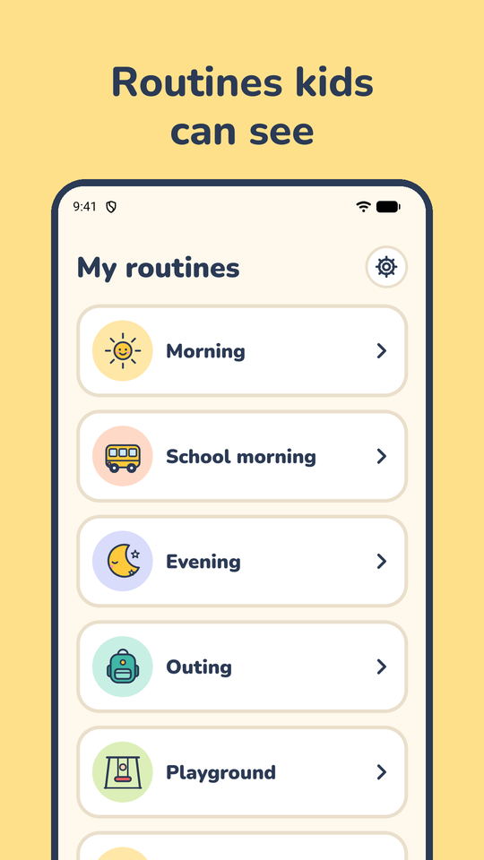
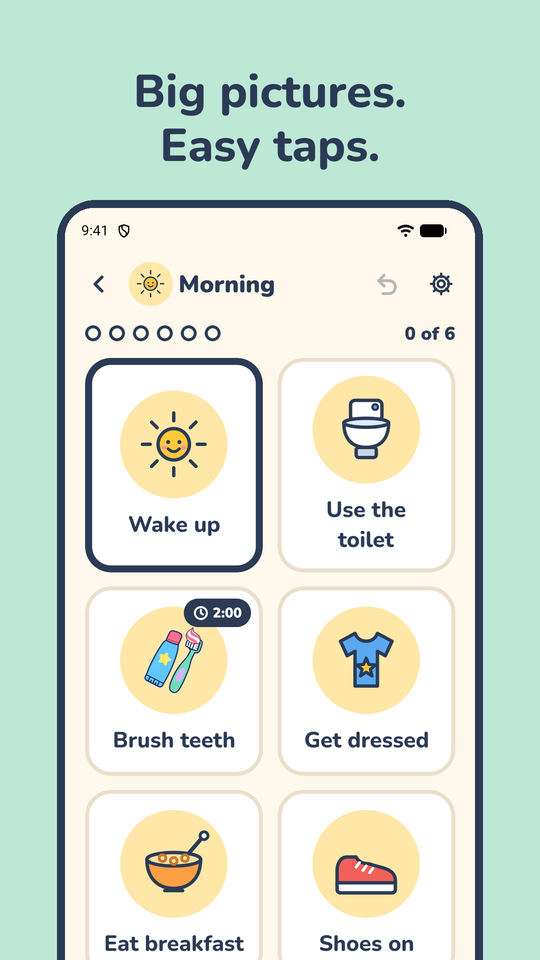
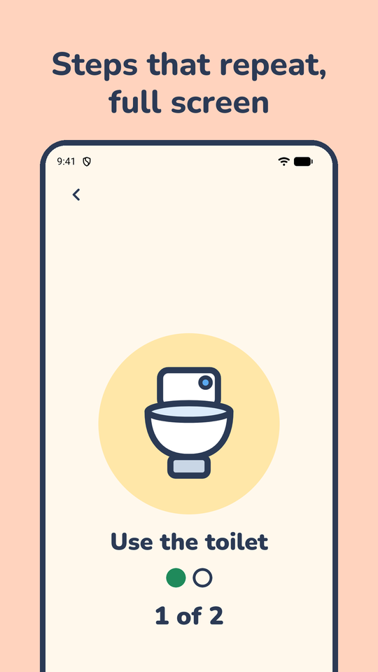
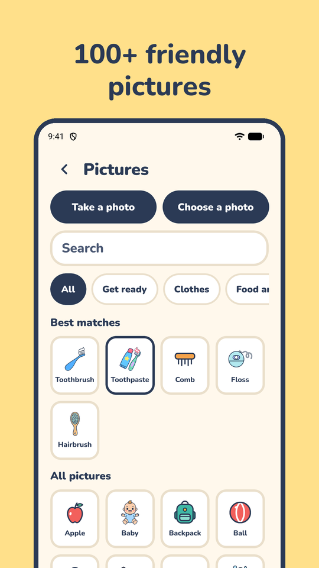
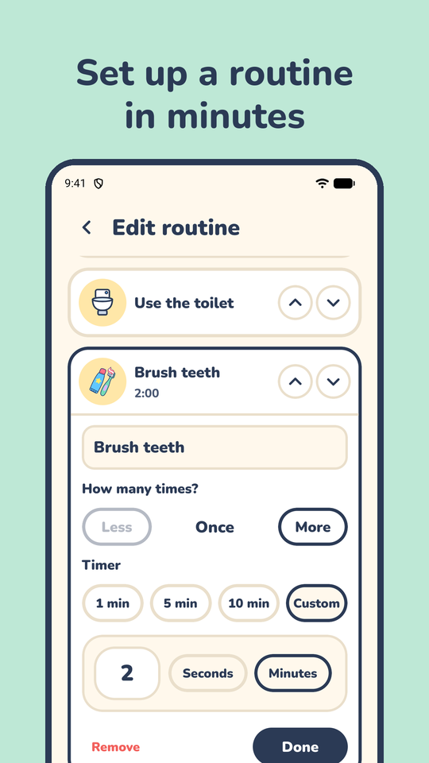

  <h2>See the plan. Tap when it's done.</h2>
  
1, 2, Go is a visual schedule app. Build a routine out of pictures, hand the device to your child, and let them tap each picture when the step is done. No reading and no typing needed.

  

    
    
    
    
    
  

  <h2>Made for the people who use visual schedules every day</h2>
  

    

      <h3>Parents</h3>
      
Little kids, and kids with ADHD, autism, cerebral palsy, Down syndrome, developmental delays, traumatic brain injury, and other disabilities. If your child does better when they can see the plan, this is for you.

    

    

      <h3>Therapists and teachers</h3>
      
Make a schedule for each child in minutes, with the pictures, timers, and repeats that fit them. Use your own photos when a built-in picture is not the right one.

    

  

  <h2>What's inside</h2>
  

    

      <h3>100+ friendly pictures</h3>
      
Getting ready, clothes, food, chores, play, sensory and movement, health, outdoors, and people. Search by word, and the best matches show up first as you type a step name.

    

    

      <h3>Your own photos</h3>
      
Take a photo or choose one from your phone. It stays on your device.

    

    

      <h3>Timers and repeats</h3>
      
Add a timer to any step, from seconds to minutes. Steps that repeat open full screen with one big picture to tap.

    

    

      <h3>Calm child view</h3>
      
Big touch targets, high contrast, and gentle motion that follows your reduce motion setting. No typing and no distractions.

    

  

  <h2>Private by design</h2>
  

    

      <h3>No account, no ads, no tracking</h3>
      
Everything you make stays on your device. The app never connects to the internet, so we never see your routines or photos.

    

    

      <h3>From the maker</h3>
      
I'm a parent of a child with Down syndrome. I built 1, 2, Go because I wanted a visual schedule that was simple, calm, and truly private, and easy for the therapists and teachers who work with our kids to use too. I hope it makes your days a little smoother.

    

  

  <h2>Coming soon to Google Play and the App Store</h2>
  
Questions or ideas? We would love to hear from you at <a href="mailto:help@margostudios.com">help@margostudios.com</a>.

  
<a href="/1st-then/privacy/">Privacy Policy</a> &nbsp;|&nbsp; <a href="/1st-then/terms/">Terms of Service</a>

  
1, 2, Go is a visual support tool for organizing routines. It is not a medical device and does not replace the guidance of a therapist, doctor, or teacher.

